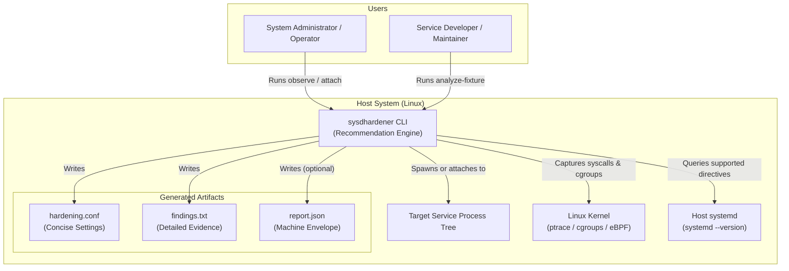
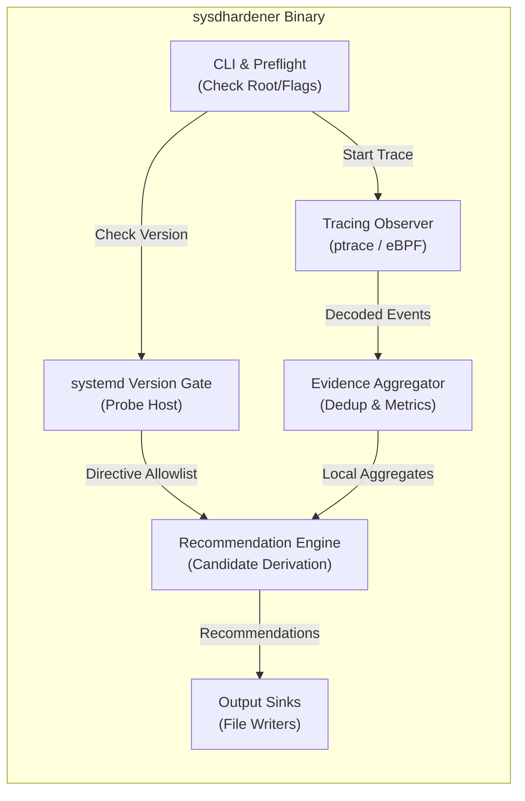

# sysdhardener: Canonical Architecture Narrative

This document is the canonical architecture and design specification for **sysdhardener**, a profiling tool for systemcall-driven hardening of systemd services. It is organized according to the arc42 architectural template, consolidating the core design decisions, runtime models, and component boundaries.

> **Scope and Status:** The repository provides an executable, test-backed Rust implementation: a CLI tool with live process-tree observation (`observe` and `attach`), deterministic fixture analysis (`analyze-fixture`), eBPF cgroup tracing, and automated recommendation generation gated by the host's systemd version. The tool is a **recommendation engine only**: it discovers provisional hardening configurations, but never automatically modifies host service units.

## Document Map

| Document | Path | Purpose |
| :--- | :--- | :--- |
| **Canonical Architecture** | [`docs/architecture.md`](architecture.md) | Central arc42 architecture narrative (this document) |
| **C4 Context View** | [`docs/architecture/c4-context.mmd`](architecture/c4-context.mmd) | System context and external actors (Mermaid) |
| **C4 Container View** | [`docs/architecture/c4-container.mmd`](architecture/c4-container.mmd) | Internal pipeline and component boundaries (Mermaid) |
| **Design Decisions** | [`docs/decisions.md`](decisions.md) | Condensed records of key design choices |
| **Wire Schemas** | [`docs/schemas.md`](schemas.md) | Input fixture and output JSON envelope specifications |
| **Research & Registry** | [`docs/research.md`](research.md) | Authoritative source registry and syscall mapping |
| **Validation & Host Baseline** | [`docs/validation.md`](validation.md) | Reference VM specification, benchmarks, and host checks |
| **Project Entry Point** | [`README.md`](../README.md) | CLI overview, installation, and usage instructions |

---

## 1. Introduction and Goals

### 1.1 Goals

sysdhardener addresses the problem of under-hardened systemd services. While modern systemd provides extensive sandboxing directives (`RestrictAddressFamilies=`, `CapabilityBoundingSet=`, `AmbientCapabilities=`, etc.), software maintainer and system administrators rarely configure them due to the fear of breaking production services.

sysdhardener profiles service execution at the systemcall boundary to produce sound, provisional hardening recommendations:

- **Syscall-driven observation:** Collect low-level syscall events as the primary evidence backbone for service behavior.
- **Recommendation-only:** Emits configurations for human review and validation; never automatically applies modifications.
- **Absence semantics:** Treats unobserved operations as validation candidates rather than absolute proof of non-use, annotating findings with explicit confidence, coverage, and contradiction conditions.
- **Runtime systemd compatibility:** Probes the host's active systemd version and omits directives that the installed systemd release does not support.
- **Deterministic and reproducible:** Validated via deterministic fixtures and tested against a pinned reference environment.

### 1.2 Non-Goals

- **Automatic enforcement:** sysdhardener is a recommendation engine only; it never modifies unit files, writes to `/etc/systemd/system/`, or applies hardening to running units.
- **Arbitrary filesystem namespace remounting:** While sysdhardener observes filesystem operations to derive `ProtectSystem=`, `ProtectHome=`, `ProtectControlGroups=`, and `ReadWritePaths=`, tracing syscall arguments alone cannot resolve complex arbitrary mount namespaces, dynamic symlink traversal race conditions, or arbitrary private submounts (such as dynamic `InaccessiblePaths=`).
- **No LSM policy auditing or generation:** The tool observes syscall requests and return codes; it does not inspect internal Linux Security Module (LSM) rule engines (such as SELinux, AppArmor, or BPF LSM) and does not generate mandatory access control policies.
- **No permanent background service:** sysdhardener is strictly an on-demand profiling CLI. It is not designed or planned to run as a continuous background daemon; observation occurs exclusively via `ExecStart=` execution (`observe`) or direct side-channel attachment (`attach` / eBPF cgroup) while profiling.

---

## 2. Constraints and Guarantees

### 2.1 Privilege and Visibility Model

- **Expected execution as root:** Complete visibility into process trees, capability operations, and cgroup socket creation requires root privileges.
- **Degraded non-root visibility:** When run without root, sysdhardener detects its effective user ID via `/proc/self/status`, prints an explicit warning, and marks observation coverage as `degraded` in report envelopes.
- **Root does not guarantee completeness:** Even under root, some kernel events may be lost or undelivered (e.g. ptrace stop limitations on certain kernels). Evidence is therefore accompanied by explicit coverage metrics.

### 2.2 Reference Environment

The primary reference environment is pinned and verified under headless QEMU/KVM with cloud-init:
- **Distribution:** Ubuntu 26.04 LTS (`resolute`), x86_64
- **Kernel:** `7.0.0-28-generic`
- **systemd:** Version 259 (`259.5-0ubuntu3`)
- **cgroups:** Unified cgroup v2 hierarchy

### 2.3 Reproducible Development Environment

- User-space tools and build dependencies are managed via **Nix** and **direnv**.
- Both the locked flake entry point (`flake.nix`) and the legacy entry point (`default.nix`) share the single source of truth in `nix/dependencies.nix`.
- Host virtualization prerequisites (KVM, libvirt) are validated read-only as described in [`docs/validation.md`](validation.md).

---

## 3. System Context

sysdhardener sits between the administrator or developer, the target service process tree, the Linux kernel tracing infrastructure, and the host systemd daemon.

### External Entities

- **System Administrators:** Profile existing services and inspect provisional recommendations for local hardening.
- **Software Maintainers:** Analyze test fixtures or staging runs to upstream hardening configurations into package units.
- **Target Process Tree:** The process and all descendants (threads, forks, execs) monitored during the profiling run.
- **Linux Kernel:** Supplies `ptrace` stop delivery, `/proc` accounting, cgroup v2 hierarchies, and optional BPF tracepoints.
- **Host systemd:** Queried at runtime to determine the host's feature level and gate emitted directives accordingly.

---

## 4. Solution Strategy

### 4.1 Syscall-First Evidence Hierarchy

Syscall observation is the primary source of truth for runtime behavior. Supplementary low-level sources are permitted only when resolving an ambiguity that raw syscall numbers alone cannot settle (e.g. cgroup hierarchy attribution).

1. **Primary evidence:** Syscall enter and exit events (name, arguments, return codes).
2. **Outcome semantics:** Events distinguish between `Success`, `Error`, `Interrupted` (EINTR/restart errnos), and `Unknown` (e.g. eBPF entry probes where return values are deferred).
3. **No fabricated certainty:** Gaps in tracer delivery or ambiguous outcomes are marked explicitly as observation gaps.

### 4.2 Recommendation-Local Aggregates

sysdhardener avoids global, persistent state or shared indexes across recommendations:
- Each candidate recommendation carries its own **local evidence aggregate**.
- Aggregates maintain event counts, earliest and latest timestamps, observed arguments, originating source IDs (`SRC-NN`), and coverage/loss metadata.
- Data structures are kept in-memory for the duration of the CLI run and serialized directly into output projections.

### 4.3 Absence-Based Candidate Analysis

Hardening often involves disabling capabilities or address families that a service *did not use*. sysdhardener formalizes this analysis:
- **Observed use vs. Non-use:** Observed successful use implies a required permission. Non-observation yields a *provisional candidate for removal*, not proof that the service will never need the capability under rare conditions.
- **Mandatory annotations:** Every absence-derived candidate includes:
  - Observation coverage state (`complete` or `degraded`)
  - Contradiction conditions (events that would invalidate the recommendation)
  - Compatibility risk description
  - Concrete validation procedure for the operator

### 4.4 Two-View Output Contract

Output presentation separates operational drop-ins from detailed reasoning:
1. **Concise settings (`hardening.conf`):** A drop-in configuration fragment containing only recommended directives. It begins with **exactly one warning header** stating that settings are provisional and require validation.
2. **Detailed findings (`findings.txt`):** A human-readable record listing every positive finding and absence candidate, alongside observed syscall counts and risk justifications.
3. **JSON report (`report.json`, optional):** A versioned machine envelope containing all finding objects, host version metadata, and known observation gaps.

---

## 5. Building Blocks and Component Flow

### Core Components

- **Preflight & CLI:** Parses CLI arguments and inspects `/proc/self/status` to assess tracer privilege.
- **Tracing Observers:**
  - `observe`: Spawns the target process under `PTRACE_TRACEME`, sets `PTRACE_O_TRACEFORK | TRACEVFORK | TRACECLONE`, and forwards termination signals.
  - `attach`: Attaches to an existing running process tree via `PTRACE_SEIZE`.
  - `bpf-observe`: Optional eBPF cgroup `sock_addr` program for zero-overhead socket tracing.
- **Evidence Aggregator:** Consumes raw events, deduplicates them by address family or capability, and records event-loss counters.
- **Version Gate:** Probes `systemd --version` (or `systemctl --version`) and suppresses directives unsupported by the target host.
- **Recommendation Engine:** Evaluates observed aggregates against the directive compatibility database (`docs/research.md`) to generate provisional findings.
- **Output Projection & Sinks:** Writes selected files (`hardening.conf`, `findings.txt`, `report.json`) with independent partial-failure isolation.

---

## 6. Runtime Observation Modes

sysdhardener operates strictly as an on-demand profiling CLI, not a permanent background service. Observation is performed via two operational models:

### 6.1 ExecStart= Launch / Transient Spawn (`observe`)

The service is spawned under `sysdhardener observe <COMMAND>` (used directly or as an `ExecStart=` drop-in command during profiling):
- Spawns the target executable under `PTRACE_TRACEME` and follows the entire process tree (`PTRACE_O_TRACEFORK | TRACEVFORK | TRACECLONE`).
- Syscall exit stops inspect arguments (such as socket domain constants) and return codes.
- **Signal forwarding:** Upon receiving `SIGINT` or `SIGTERM`, the observer forwards the signal to the child tree to trigger clean service shutdown (matching the systemd `systemctl stop` flow) before analyzing results and writing output artifacts.

### 6.2 Direct Side-Channel Attachment (`attach` & eBPF cgroup)

The tool attaches externally to an already-running service without altering the unit's command line:
- **ptrace attach (`attach`):** Attaches to an existing running process PID via `PTRACE_SEIZE`, monitoring active worker threads and newly spawned children until detached or until the process exits.
- **eBPF cgroup observer (`bpf-observe` feature):** For environments with root and `CAP_BPF` on unified cgroups, attaches an in-kernel BPF program to the target unit's cgroup v2 hierarchy. It captures `sock_addr` hooks directly in kernel space and streams events to user space over an eBPF ring buffer, eliminating ptrace stop overhead for high-throughput network services.

---

## 7. Key Architectural Decisions

The following foundational decisions guide the implementation:

1. **Recommendation Engine Only:** The tool never writes to `/etc/systemd/system/` or modifies running units.
2. **Dynamic Host Version Gating:** Directives are filtered based on the active systemd
   version (e.g. `CapabilityBoundingSet=` since v1, `AmbientCapabilities=` since v229, `RestrictAddressFamilies=` since v235, `ProtectSystem=` / `ProtectHome=` since v214, `ProtectControlGroups=` since v232, and `ReadWritePaths=` since v231).
3. **No Fabrication of Facts:** Systemd directive support and kernel syscall mappings are grounded in authoritative sources (`SRC-01` through `SRC-14`) recorded in [`docs/research.md`](research.md).
4. **Single Warning Header on Concise Output:** The concise `hardening.conf` begins with a single warning line, followed strictly by directives for ease of consumption.
5. **Partial Sink Failure Isolation:** If multiple output sinks are requested and one fails (e.g. read-only filesystem for JSON output), remaining files are preserved and the CLI exits with code `5`.

---

## 8. Status of Research Boundaries and Open Questions

During initial discovery, several technical questions and boundaries were cataloged. Their current status is summarized below:

| Topic | Discovery Question | Current Status in Implementation |
| :--- | :--- | :--- |
| **Reference Baseline** | Pinned distribution and versions | **Resolved & Verified.** Validated on Ubuntu 26.04 LTS, kernel 7.0, systemd 259, cgroup v2. |
| **systemd Versioning** | Host compatibility validation | **Resolved & Implemented.** Runtime probe dynamically queries `systemd --version` and gates directives. |
| **Observer Modes** | Transient spawn vs. attach | **Resolved & Implemented.** Both `observe` (spawn/`ExecStart=`) and `attach` (side-channel `PTRACE_SEIZE`) are supported. |
| **eBPF Integration** | BPF feasibility and data sharing | **Resolved & Implemented.** eBPF cgroup program and loader communicate via shared `sysdhardener-wire-format`. |
| **Aggregator State** | In-memory vs. persistent database | **Resolved & Implemented.** Per-run in-memory aggregation with no background daemon cache. |
| **Nix Dev Shells** | Flake and non-flake consistency | **Resolved & Implemented.** Both entry points consume `nix/dependencies.nix` (verified by CI). |
| **Operational Model** | Permanent service vs. on-demand CLI | **Resolved & Scoped.** Strictly scoped to on-demand CLI profiling via `ExecStart=` launch (`observe`) or direct side-channel attachment (`attach` / eBPF cgroup). Permanent background daemonization is explicitly out of scope. |
| **Privilege Model** | Privilege handling and dropping | **Resolved.** Requires root for comprehensive observation; warns and marks coverage degraded on non-root. Because the tool runs on demand during profiling and exits upon completion, running as root during trace and terminating is the complete, intended model. |
| **Non-Syscall Hooks** | Supplementary hooks (LSM/VFS) | **Resolved for CLI.** Current recommendations derive purely from syscalls; non-syscall hooks are deferred. |

---

## 9. Glossary

- **sysdhardener:** The profiling and hardening recommendation engine.
- **provisional recommendation:** A candidate configuration derived from observation, requiring human validation before deployment.
- **absence candidate:** A directive recommending the removal or restriction of a facility because no successful use was observed.
- **event outcome:** The classification of a syscall attempt (`Success`, `Error`, `Interrupted`, or `Unknown`).
- **version gate:** The logic that verifies whether the host systemd version supports a given directive before emitting it.
- **source identifier (`SRC-NN`):** A stable identifier linking a compatibility rule or syscall mapping to its authoritative documentation source.
